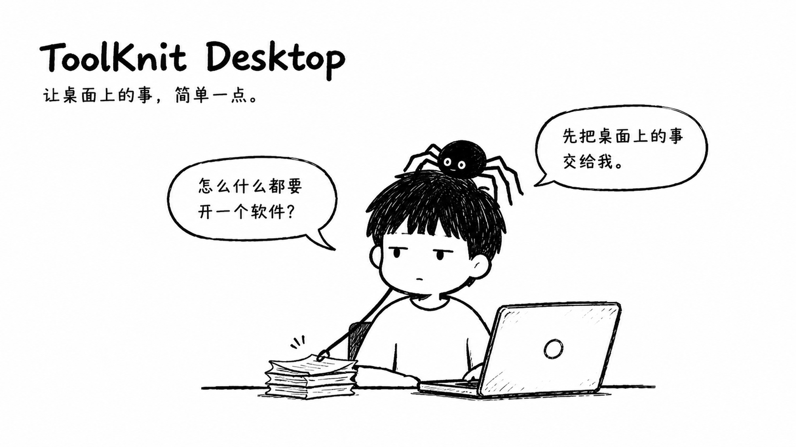
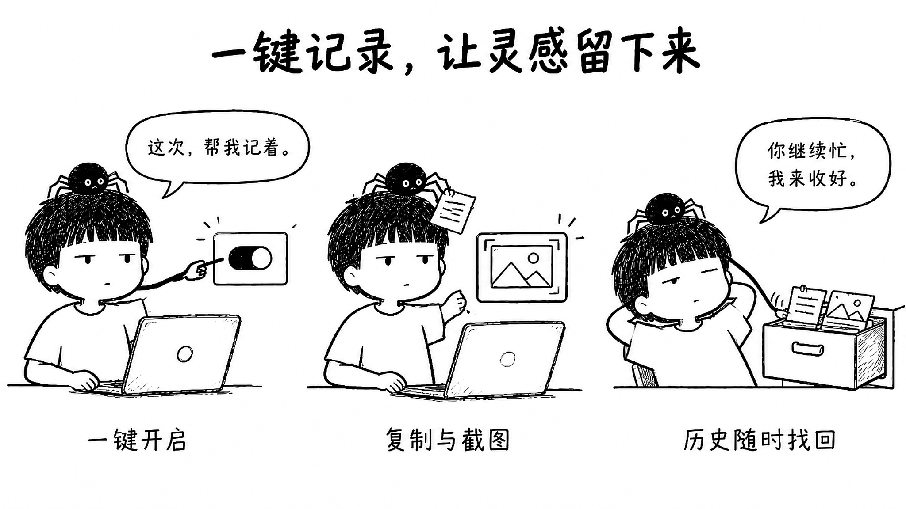
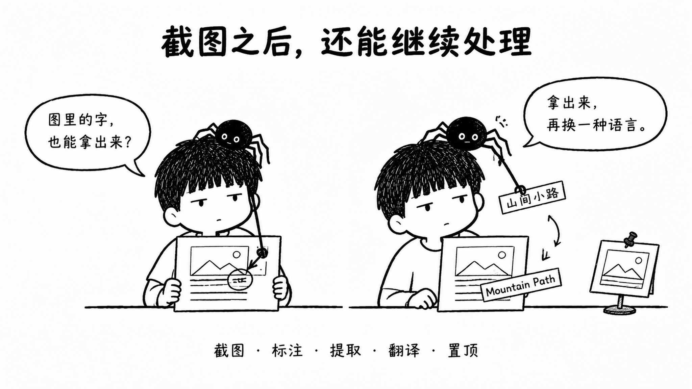
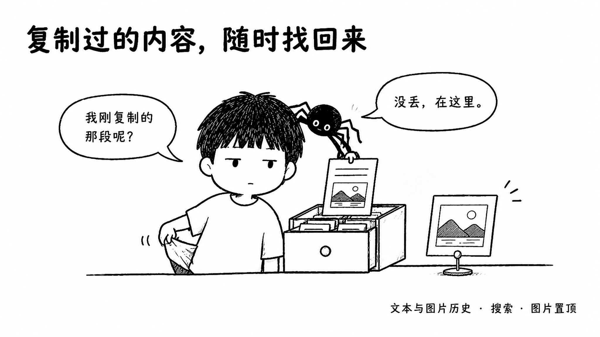
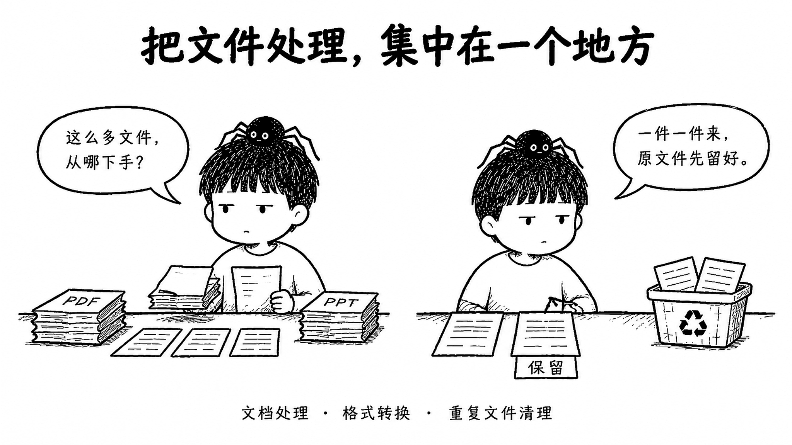
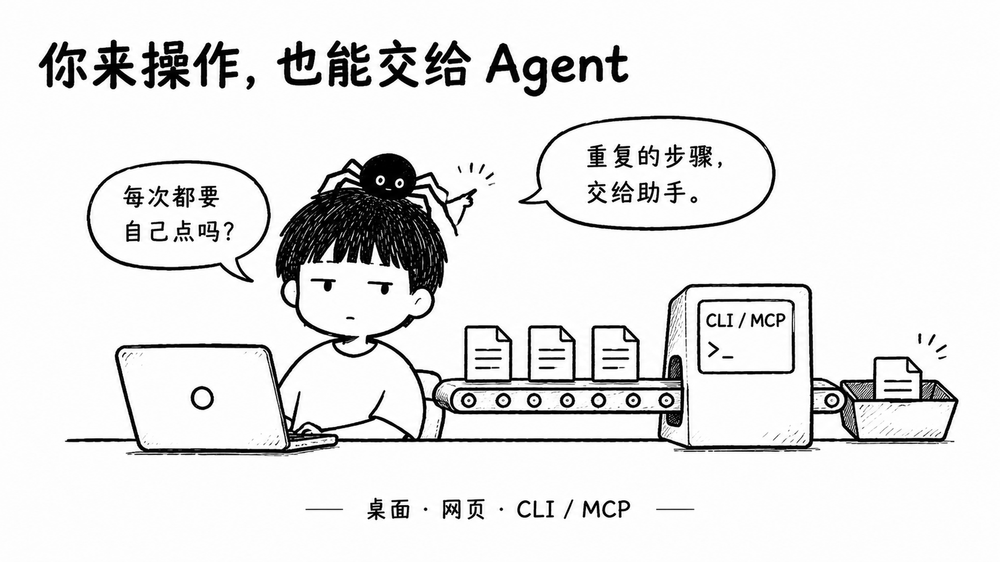
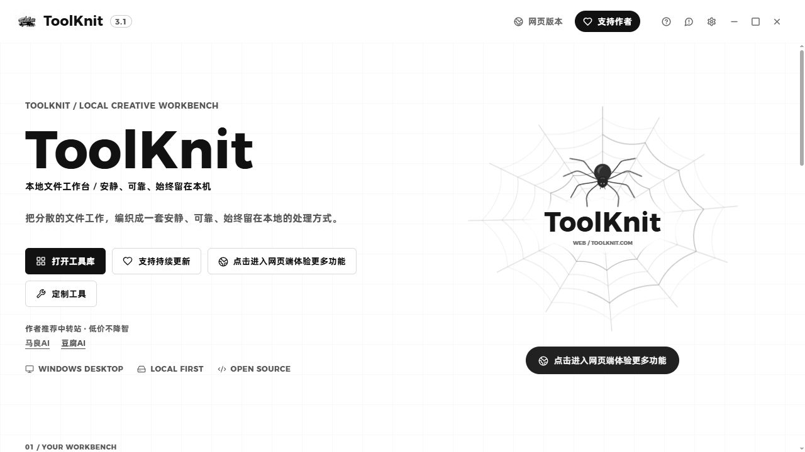
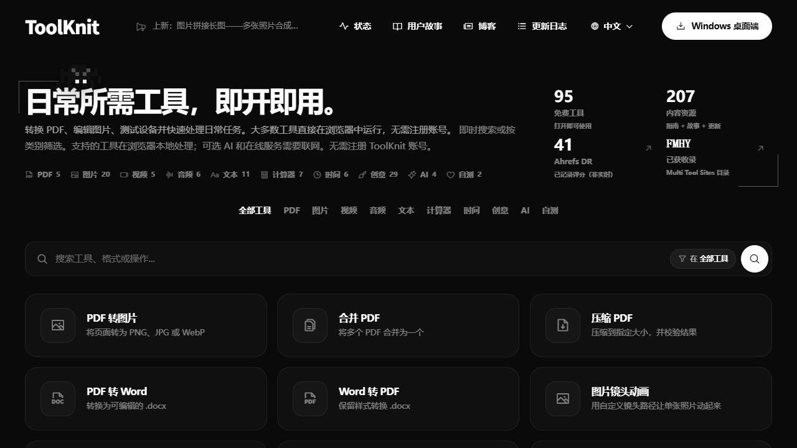
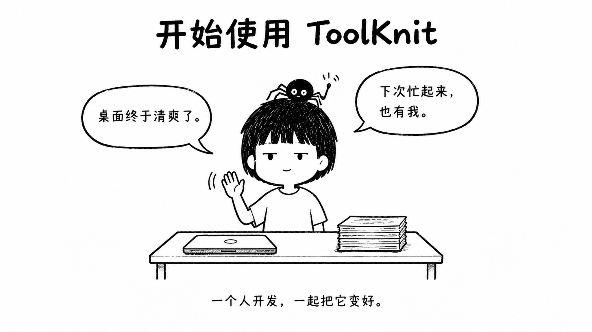

<div align="center">



# ToolKnit Desktop 3.1

**One toolbox for the little tasks scattered across your desktop.**

71 desktop tools · 12 categories · Local file workflows · CLI / MCP

[Download for Windows](https://toolknit.com/exe.html) · [Open the web app](https://toolknit.com) · [简体中文](README.md)

</div>

## 01 / Fewer apps, more things done

Crop a PDF page. Find the text you just copied. Annotate a screenshot. Remove an image background.
Small jobs often mean switching between several applications.

ToolKnit brings PDF, PPT, image, audio, video, text, system and developer tools together.
Use the desktop app for local files, the web app for quick access, and CLI or Agents for suitable automated workflows.

[Recording mode](#02--keep-the-things-you-want-to-remember) · [Screenshots](#03--a-screenshot-is-just-the-start) · [Tool catalog](#complete-tool-catalog) · [Get started](#08--get-started) · [License](#source-license)

## 02 / Keep the things you want to remember



**Enable one mode in Settings to bring three features together.**

| Enabled together | What it does |
| --- | --- |
| Start with Windows | Keeps ToolKnit ready in the system tray after a restart |
| Live clipboard monitoring | Records newly copied text, images and file paths |
| Floating screenshot history | A draggable Logo opens your recent confirmed screenshots |

Recording mode is opt-in. Turning it off restores the relevant settings from before activation; the individual controls remain available.
It does not log keystrokes, browsing or all system activity. Monitoring stops when the application fully exits.

## 03 / A screenshot is just the start



**Press `Alt + Q` by default to capture a window or region.** You can change or disable the shortcut.

Annotate with rectangles, circles, arrows, pen strokes, brush-style mosaic and text.
Undo, redo, and hold to compare with the original. Copy or save PNG / JPG, then zoom, pan or pin the result in an independent viewer.
Open the floating history panel to revisit earlier screenshots.

| Task | How it works |
| --- | --- |
| Extract text | Local Windows OCR; small text, complex backgrounds and layouts can reduce accuracy |
| AI extraction | Sends the selected region to your configured image-capable model for text extraction |
| Screenshot translation | Requires the local Chinese / English model installed in Settings; recognition is followed by local translation and an image overlay |

Screenshot translation supports **Chinese and English only**. With a configured AI URL, model and saved key, local OCR locates text and AI corrects it against the image before local translation. Without AI configuration, it uses local OCR directly.
AI correction failures explain the cause and require your confirmation before falling back to OCR. If text cannot fit, the full translation remains available to copy.

Translation components are downloaded on demand: approximately **192 MiB downloaded / 225 MiB installed**, separate from the main installer.
Local translation time is not the whole screenshot workflow time; external AI latency depends on the provider. Check recognition and translation results.

## 04 / Find what you copied



**The note you copied a moment ago does not have to disappear.**

Clipboard history keeps a timeline of text, images and file paths with search, filters, favorites and local encryption.
Open an image record directly in the pinned viewer. Confirmed ToolKnit screenshots copied to the clipboard are captured while monitoring is enabled.
The monitoring preference persists across restarts.

Only new clipboard content after activation is recorded; existing Windows Win + V history is not imported.
Clipboard content can be sensitive, so pause monitoring and clear records as needed.

## 05 / Keep file work in one place



**Move from preview to output with fewer detours.**

| Workflow | Common tasks |
| --- | --- |
| PDF | Merge, split, crop, page numbers, rotate, export images, compress, encrypt, decrypt, edit and extract text / Markdown |
| PPT | Export PDF / images, extract pictures and text, compress, generate AI outlines or editable PPTX drafts |
| Cleanup | Analyze large files, clean C drive and scan duplicates by file type |

Text-layer PDF extraction does not require an AI key; scanned documents and complex layouts can use AI vision workflows.
Duplicates are checked by content. Nothing is selected for deletion by default, at least one file is kept per group, and files are rechecked before being moved to the Recycle Bin.

File tools preserve originals by default and write results to the output directory.
**Visual covering in the PDF editor is not secure redaction**, and a scanned-style PDF does not prevent copying.
Cleanup safeguards cannot replace your judgment about your files.

## 06 / A workbench for pictures and sound


Crop, compress, convert and stitch images; generate icons or remove backgrounds with a local model.
Convert audio and video, trim audio, extract sound, capture video frames, create GIFs, transcribe offline and edit Markdown.

FFmpeg, LibreOffice, transcription and background-removal models are detected and installed on demand.
Existing usable runtimes are reused where supported. WPS / Microsoft Office is not LibreOffice and cannot substitute for conversion workflows that need `soffice`.

## 07 / Work by hand, or hand it to an Agent



**Desktop for visual interaction. CLI for batches. Agents for orchestration.**

Suitable automated tasks are available through `@toolknit/cli` and **46 CLI / MCP capabilities**.
Their scope differs from the desktop catalog; not all 71 desktop tools are callable from the CLI.

```powershell
npm install --global @toolknit/cli
toolknit doctor --json
toolknit --help
```

<details>
<summary><strong>Connect an MCP-compatible client</strong></summary>

```json
{
  "mcpServers": {
    "toolknit": {
      "command": "toolknit",
      "args": ["mcp", "serve"]
    }
  }
}
```

Basic file capabilities do not require an AI key. AI workflows require `DEEPSEEK_API_KEY` or `TOOLKNIT_AI_API_KEY` in the CLI / MCP process environment, as specified by the command contract.

[CLI / MCP contract](toolknit-desktop/docs/cli-agent.md) · [English Agent guide](toolknit-desktop/docs/agent-guide.en.md) · [中文 Agent 手册](toolknit-desktop/docs/agent-guide.zh-CN.md)

</details>

## The actual workspaces

### Windows desktop



An actual capture of this repository's 3.1 home interface, rendered in a browser and converted to grayscale. Native file, shortcut and system features require the installed Windows app.

### No-install web app



An actual capture of [ToolKnit.com](https://toolknit.com), converted to grayscale. Desktop and web tool scopes, dependencies and offline support follow each product's own documentation.

The comics share the approved Chinese-language artwork in both READMEs. Their accessible descriptions and the surrounding English text explain each scene and feature.

## 08 / Get started



| Entry | Best for |
| --- | --- |
| [Download for Windows](https://toolknit.com/exe.html) | Local file workflows, recording mode and screenshots |
| [Open ToolKnit.com](https://toolknit.com) | Quick access and cross-platform use without installation |
| [Install the CLI](https://www.npmjs.com/package/@toolknit/cli) | Scripts, batch processing and MCP Agents |

Requires Windows 10 **1803 / build 17134 or later**, or Windows 11, and Microsoft Edge WebView2 Runtime.
The installer embeds the WebView2 bootstrapper; downloading a missing runtime still requires a network connection. Windows 7 / 8 / 8.1 are unsupported.
Available installer versions follow the download page. See the [code signing policy](CODE_SIGNING_POLICY.md) for signing status.

### Local first, with clear boundaries

Ordinary file tasks run locally by default. When you actively use an AI feature, necessary file content or screenshot regions are sent to your configured provider.
Dependency downloads and update checks need a connection; installed offline capabilities do not require an AI key.
File-size, page, pixel and batch limits vary by tool; support is not unlimited for every format.

### Run from source

```powershell
git clone https://github.com/ZihangDong/toolknit-desktop.git
Set-Location toolknit-desktop
git switch codex/readme-v3.1-comic-preview
Set-Location toolknit-desktop
npm ci
npm run tauri dev
```

Requires Node.js **22.12+** (24 recommended), Rust stable, Visual Studio C++ Build Tools, Windows SDK and WebView2.
The repository root holds documentation; the nested `toolknit-desktop/` directory is the npm / Tauri project.
See the [build guide](BUILD.md). This branch previews the README and does not announce an installer release.

## Complete tool catalog

<details>
<summary><strong>Expand 71 desktop tools / 12 categories</strong></summary>

| Category | Count | Tools |
| --- | ---: | --- |
| PDF | 14 | Merge, split, page numbers, crop, export images, scanned-style PDF, text / Markdown extraction, editor, rotate, encrypt, decrypt, compress, text enhancement, Excel to PDF |
| PPT | 7 | Export PDF, export images, extract images, AI text extraction, compress, AI outline, AI draft / PPTX |
| Image | 7 | Crop, smart color replacement, background removal, format conversion, compress, stitch, icon generator |
| Audio | 4 | Format conversion, BPM measurement, trim, extract audio |
| Video | 3 | Format conversion, full-resolution frame, GIF clipping |
| Text | 5 | Markdown editor, media transcription, teleprompter, text statistics, text formatting |
| Calculator | 5 | Body fat, timestamp, mortgage, interest, password generator |
| Creative | 3 | Palette extraction, color-space comparison, typing test |
| Cleanup | 3 | AI large-file cleanup, C drive cleanup, duplicate files |
| AI | 6 | PDF to Markdown, text polishing, translation, document generation, spreadsheet generation, quick screenshot |
| Hardware | 8 | System overview, CPU / memory, GPU / displays, motherboard / firmware, storage / health, network / devices, power / sensors, clipboard history |
| Developer | 6 | JSON formatting, Base64, URL encoding / decoding, UUID, JWT viewer, Hash & Crypto |

</details>

## One developer, improved together

| Contributor | Contribution |
| --- | --- |
| [Zihang Dong](https://github.com/ZihangDong) | Author, product design, development and maintenance |
| [Joshua-Zion](https://github.com/Joshua-Zion) | Color-space conversion and interaction: [PR #23](https://github.com/ZihangDong/toolknit-desktop/pull/23), [PR #67](https://github.com/ZihangDong/toolknit-desktop/pull/67) |
| [hqyx2025](https://github.com/hqyx2025) | Project verification and bug testing |

Thanks to [AtomGit](https://atomgit.com/) for code hosting and developer collaboration. Repository mirror: [AtomGit / ToolKnit Desktop](https://atomgit.com/ZihangDong/toolknit-desktop).

[Report a bug](https://github.com/ZihangDong/toolknit-desktop/issues/new?template=bug_report.yml) · [Suggest a feature](https://github.com/ZihangDong/toolknit-desktop/issues/new?template=feature_request.yml) · [Contribution guide](CONTRIBUTING.md)

If ToolKnit saves you time, a Star or [one-time donation](assets/readme/donation-support.webp) helps support development, AI testing and maintenance.
[Thank you to our supporters](assets/readme/supporters-thanks.webp). Donations do not purchase a feature or promise implementation.
Custom tools and commercial licensing: WeChat **wunanvip6**; email [2645149786@qq.com](mailto:2645149786@qq.com).

The comics were created with AI assistance, referencing the sparse black-and-white linework of [handraw-style / FH-023 · Deadpan Doodle](https://github.com/yang0/handraw-style/blob/master/images/individual/FH/FH-023.webp).
They depict new scenes with the project characters rather than reproducing the reference illustration. See the [asset notes](assets/readme/README.md).

## Source license

From **2026-10-14**, newly licensed author code and modifications use [PolyForm Noncommercial 1.0.0](LICENSE).
Noncommercial use, modification and redistribution must follow the license and preserve required notices; contact the author for commercial permission. Copyright remains with the respective authors.
This is a source-available noncommercial license, **not an OSI-approved open-source license**.

Previously granted Apache-2.0 rights are not revoked. Unmodified code previously released under Apache-2.0 and third-party contributions retain their original grants.
See [Apache-2.0](LICENSES/Apache-2.0.txt), [NOTICE](NOTICE) and version history.
Third-party dependencies, fonts, models and runtimes retain their own licenses. ToolKnit branding, domains and hosted web services are not licensed by the source license.
